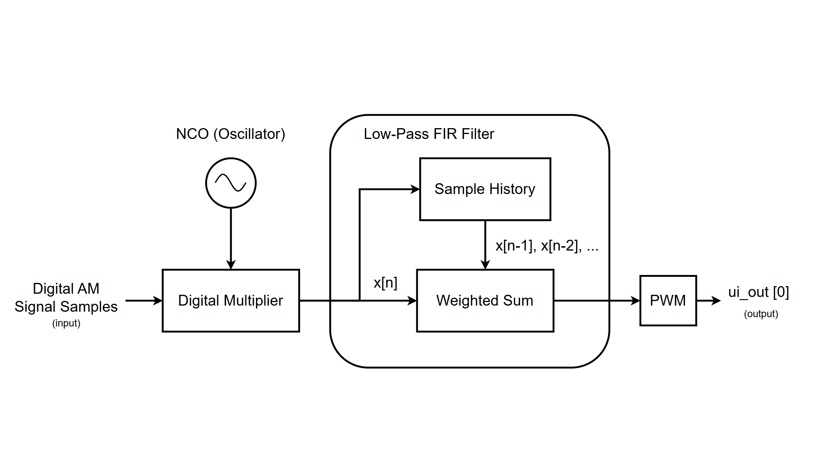

# Updated Design Proposal & Timeline

---

### 1. Statement of Purpose

Digital Radio Backend: The purpose of this project is to design a digital radio backend that implements the final demodulating and filtering stages of an AM radio. It operates on a clean, pre-filtered digital AM input that is at 455 kHz IF and utilizes a synchronous multiplier to demodulate the signal down to baseband and a FIR decimation filter to extract a clean audio output.

### 2. System Diagram

### 3. I/O Pin Assignments

| **I/O Pin** | **Usage** |
| --- | --- |
| ui_in[7:0] | Dedicated input: digital 8-bit IF input |
| ui_out [0] | Dedicated output: PWM output signal |
| ui_out [1] | Dedicated output: NCO debug output |
| clk | Clock |
| rst_n | Active-low system reset |

### 4. Proposed specification

| **Specification** | **Value** | **Notes** |
| --- | --- | --- |
| Input Carrier Frequency | 455kHz | Industry standard frequency for IF |
| Input bit width | 8-bits | Contains amplitude information of the incoming AM signal |
| Clock Speed | 1MHz | This is roughly twice the input carrier frequency to ensure we can accurately reproduce the message signal |
| Message frequency to preserve (FIR Filter) | 0 - 5kHz | |

**To be determined:** Other FIR filter specs like the number of taps & coefficient values will need to be determined through testing.

### 5. Timeline of completion / Who Does What?

| Date | Description of Tasks |
| --- | --- |
| Week 9  (Nov 5 - Nov 12) | Get a first draft of the Verilog code finished: • Multiplier [ Angela ] • PWM Output [ Angela ] • FIR Filter Implementation [ Ethan ] &nbsp;&nbsp;&nbsp;&nbsp;◦ Initial draft of parameters/taps &nbsp;&nbsp;&nbsp;&nbsp;◦ Basic first tests to verify parameters |
| Week 10  (Nov 12 - Nov 19) | Testing (CocoTB): • Full set of unit tests for each module &nbsp;&nbsp;&nbsp;&nbsp;◦ Multiplier & PWM tests [ Angela ] &nbsp;&nbsp;&nbsp;&nbsp;◦ Verify parameters set for FIR [ Ethan ] • Set of end-to-end tests [ Both ]  Evaluate the size of the project, make sure it fits. |
| Week 11  (Nov 19 - Nov 26) | Review / Testing [ Both ]: • Work on any areas that require attention: &nbsp;&nbsp;&nbsp;&nbsp;◦ Continue with creating tests &nbsp;&nbsp;&nbsp;&nbsp;◦ Verify FIR parameters &nbsp;&nbsp;&nbsp;&nbsp;◦ Work on reducing size of project |
| Week 12  (Nov 26 - Dec 3) | Review / Documentation [ Both ]: • Update all documentation on GitHub (`/docs` folder) • Final preparations for Final Submission • Wrap up anything that remains to be completed. |